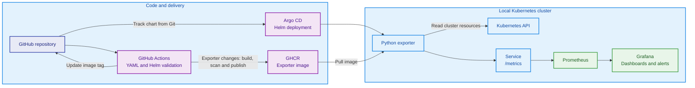

# Kubernetes Resource Monitoring

## Introduction

A personal Kubernetes monitoring project that collects cluster resource and Warning event metrics. A Python exporter exposes the data to Prometheus, with Grafana used for dashboards and alerting. The project uses Helm and Argo CD for deployment, and GitHub Actions for validation and image delivery.

Dashboard panels and alert rules are still being developed.

## Architecture

## Dashboard

Dashboard and alerting

This section is reserved for final dashboard screenshots and a short explanation of the panels and alert rules.

## Troubleshooting

Health and readiness checks

The exporter uses `/healthz` for liveness and `/readyz` to check Kubernetes API access before receiving traffic.

## What I learned

Kubernetes and deployment

- Deploy workloads with Kubernetes and package the exporter with Helm.
- Configure API access with RBAC and health checks with probes.
- Use Argo CD to reconcile a Helm deployment from Git.

CI/CD and monitoring

- Use GitHub Actions path filters to avoid image builds for Kubernetes-only changes.
- Build, scan, and publish container images to GHCR.
- Expose metrics to Prometheus with a ServiceMonitor and explore them with PromQL.

