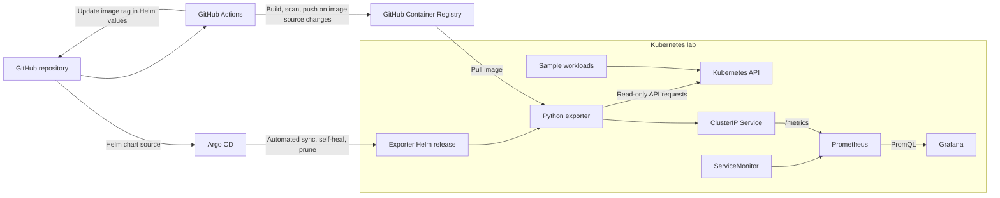

# Kubernetes Resource Monitoring

A personal DevOps lab for collecting Kubernetes resource metrics with a Python exporter, Prometheus, and Grafana. The project uses Docker Desktop Kubernetes and WSL2 with kind as local lab environments.

## Architecture



The exporter reads live cluster state through the Kubernetes API. It does not parse `temp_app.yaml`; that file provides sample workloads to apply to the cluster. Prometheus discovers the exporter through a `ServiceMonitor`. The Grafana dashboard JSON files are kept in the repository for import and reference.

## Current metrics

- `k8s_pods`: pod/container image and phase information
- `pods_restart_count`: total container restarts per pod
- `pod_age`: pod age in hours
- `k8s_deploy`: deployment ready-replica percentage (`-1` when desired replicas are zero)
- `k8s_namespace`: namespace state
- `k8s_resource_event`: Warning event counts and details

The exporter currently queries pods, deployments, namespaces, and Kubernetes events. Its ClusterRole also includes read access to nodes, services, and ConfigMaps for possible future metrics.

## Repository layout

```text
src/main.py                         Python Prometheus exporter
kubernetes/helm-monitor/            Exporter Helm chart and sample workloads
kubernetes/prometheus/values.yaml   Prometheus stack values
kubernetes/grafana/                 Grafana values and dashboard JSON files
kubernetes/argocd/                  Argo CD Application manifest
.github/workflows/CI.yaml           Validation, image build, scan, and publish workflow
```

## CI/CD

GitHub Actions runs for relevant pushes to `main` and can also be started manually. YAML linting and Helm chart validation run for workflow executions. The Docker image is built and scanned with Trivy only when `Dockerfile`, `src/main.py`, or `requirements.txt` changes. On `main`, a successful scan is followed by a push to GHCR and an update to the image tag in the Helm values file.

Argo CD tracks `kubernetes/helm-monitor` from the `main` branch and is configured for automated sync, self-healing, and pruning.

## Run in a local cluster

Prerequisites: `kubectl`, Helm, a Kubernetes cluster, and a Prometheus installation with the Prometheus Operator.

Apply the sample workloads and install the exporter chart:

```powershell
kubectl apply -f kubernetes/helm-monitor/temp_app.yaml
helm upgrade --install helm-monitor ./kubernetes/helm-monitor `
  --namespace helm-monitor --create-namespace
```

The chart defaults to the image and tag in `kubernetes/helm-monitor/values.yaml`. To use a locally built image instead:

```powershell
docker build -t helm-monitor:dev .
helm upgrade --install helm-monitor ./kubernetes/helm-monitor `
  --namespace helm-monitor --create-namespace `
  --set image.repository=helm-monitor --set image.tag=dev
```

For kind, load the local image into the cluster before installing the chart:

```powershell
kind load docker-image helm-monitor:dev --name <cluster-name>
```

The Prometheus and Grafana components are installed separately from the exporter chart. Import a dashboard JSON file from `kubernetes/grafana/` into Grafana to explore the collected metrics.


