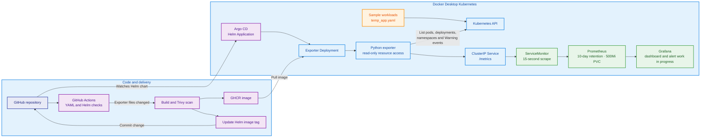

# Kubernetes Resource Monitoring

## Introduction

A small Kubernetes monitoring lab. A Python exporter reads live cluster resources through the Kubernetes API and exposes metrics for Prometheus. Grafana is used to explore the metrics and build dashboards and alerts.

GitHub Actions validates the manifests and Helm chart. When exporter code or its build files change, it builds and scans a container image, publishes it to GHCR, and updates the Helm image tag. Argo CD deploys the chart to the local Kubernetes cluster.

## Architecture

`temp_app.yaml` creates sample resources in the cluster. The exporter reads the live Kubernetes API; it does not read that YAML file directly. Argo CD is configured to ignore Deployment image differences.

## Dashboard

Dashboard 1 — add title

<!-- Add a screenshot here when ready, for example:  -->

- **Purpose:** Add a short description.
- **Panels and queries:** Add notes here.
- **Alerts:** Add rule and notification notes here.

Dashboard 2 — add title

<!-- Add a screenshot here when ready, for example:  -->

- **Purpose:** Add a short description.
- **Panels and queries:** Add notes here.
- **Alerts:** Add rule and notification notes here.

## Troubleshooting

Issue — add a short title

- **Symptom:** What happened?
- **Cause:** What caused it?
- **Fix:** What resolved it?

## What I learned

Kubernetes and Helm

- Deploy workloads and inspect their state across namespaces.
- Package the exporter with Helm templates and values.
- Give the exporter read access through Kubernetes RBAC.
- Use `/healthz` for liveness and `/readyz` to check Kubernetes API access.

Metrics and monitoring

- Expose application metrics from Python at `/metrics`.
- Connect a Service, ServiceMonitor, and Prometheus scrape configuration.
- Use PromQL to handle duplicate series with `max without`.
- Check series count, retention, and storage when reviewing metric labels.

CI/CD and GitOps

- Use GitHub Actions path filters so Kubernetes-only changes do not build an image.
- Validate YAML and Helm charts in CI.
- Build, scan, and publish exporter images to GHCR when exporter build files change.
- Use Argo CD to track the Helm chart and reconcile the cluster with Git.

