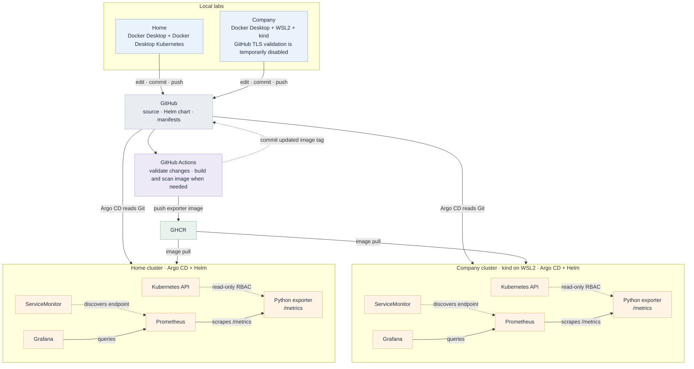

# Kubernetes Resource Monitoring

## Introduction

A personal project for collecting Kubernetes resource and Warning-event metrics. A Python exporter reads cluster information and exposes it to Prometheus. The project uses GitHub Actions, GHCR, Helm, and Argo CD to deliver the application to two local Kubernetes labs.

## Architecture



## Dashboard

<details>
<summary>Grafana dashboard screenshots</summary>

[Dashboard JSON](kubernetes/grafana/dashboard.json)


</details>

## Design Decisions

<details>
<summary>What did I design it like that?</summary>

<details>
<summary>   Exporter</summary>

1. Why implement custom metrics? <br>
     This project was created to gain hands on expeerience with a complete DevOps monitoring workflow. <br>
     Instead of relying only on existing Kubernetes metrics, I implemented a custom exporter to better understand:
      - How data is collected from the Kubernetes API
      - How metrics are exposed to Prometheus
      - How Prometheus stores and queries metrics
      - How Grafana visualized operational data

2. Deployment Readiness Percentage <br>
     Deployment status is calculated as:
     ```python
     Ready Replicas / Desired Replicas * 100
     ```
    
     instead of simply checking whether the Deployment exists. <br>
     This allows operators to quickly identify the current deployment health status:
     |  Value  |  Meaning  |
     |---------|-----------|
     |   100   |  Fully Healthy |
     |  1-99   |  Need to be Checked  |
     |    0    |  No Available Replica  |
     |   -1    |  Replica Information Unavailable  |

3. Pod Restart Count From a Pod Perspective  <br>
     Kubernetes provides restart counts per container. <br>
     Restart counts are aggregated at the Pod level: <br>
     ```python
     sum(status.restart_count for status in container_statuses)
     ```
     I added this becuase operational troubleshooting is typically performed from a Pod perspective rather than an individual container perspective.

4. Kubernetes API Based Readiness Check  <br>
     In Readiness probe, this exporter request 1 namespace instead of HTTP 200 response. <br>
     ```python
     v1.list_namespace(limit=1, _request_timeout=5)
     ```
     It verifies
     - Kubernetes API availability
     - Authentication status
     - RBAC permission
     - API response latency

</details>


   <details>
   <summary>   Github Actions</summary>
1. Why use jobs.changes? <br>
     The pipeline uses path based filtering to determine whether a container image rebuild is required <br>
     It reduces
     - Unnecessary Docker builds
     - Unnecessary Trivy scans
     - Unnecessary image pushes
     Also it shortens CI execution time

2. Manifest Validation Before Image Build <br>
     It is perfermed before the Docker build stage
     - YAML validation (yamllint)
     - Helm validation (helm lint)
     This allows configuration errors to be detected early and prevents unnecessary image creation

3. Dual Image Tag Strategy (SHA + latest) <br>
     Commit SHA
     - Immutable
     - Traceable
     - Unique
     Latest
     - Easy reference for operator
     - Indicates the most recent successful build

4. GitOps Based Deployment <br>
     The pipeline does not directly deploy workloads to Kubernetes
     - Build Image → Push Image → Update Image tag in values.yaml → ArgoCD detects change → Apply in deployment <br>
     This keeps Git as the single source of truth and follows GitOps principles <br>
     The workflow also uses [skip ci] to prevent infinite CI loops when updating image tags <br>

5. Why export Warning Events only? <br>
     Normal Events were excluded because they generate large amounts of operational noise and provide limited value during incident investigations

</details>


</details>

## Troubleshoot / Challenges

<details>
<summary>Local containers and Kubernetes labs</summary>

- Set up separate home and company labs with Docker Desktop Kubernetes and kind on WSL2.
- Built and published a Python exporter image to GHCR.

</details>

<details>
<summary>GitHub Actions and GitOps</summary>

- Used GitHub Actions to validate changes and build the image only for relevant source changes.
- Added image scanning and Helm image tag updates to the delivery flow.
- Connected the Helm deployment to Argo CD so cluster state is managed from Git.

</details>

<details>
<summary>Prometheus and Grafana</summary>

- Exposed exporter metrics and configured Prometheus discovery through a ServiceMonitor.
- Practiced PromQL queries, including handling duplicate series with `max without`.
- Explored Grafana panels using the metrics collected by the project.

</details>
